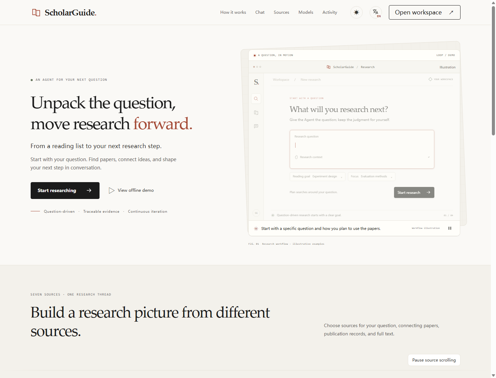
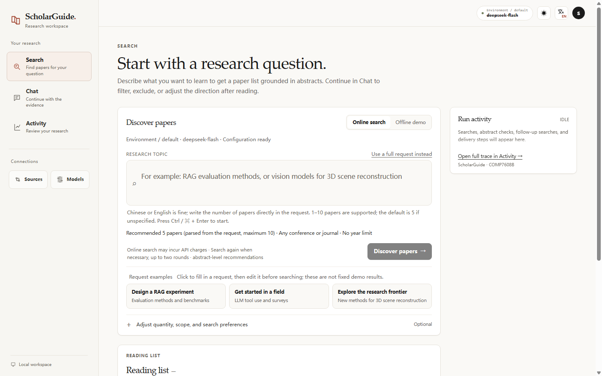
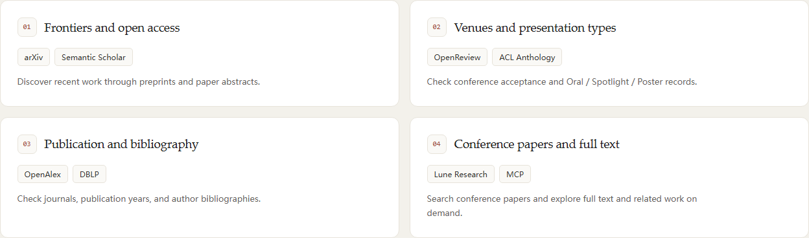
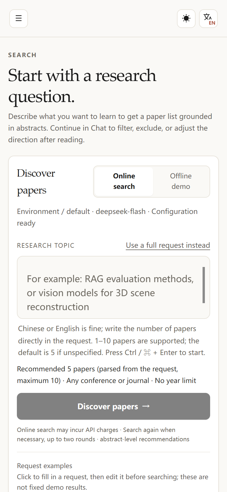
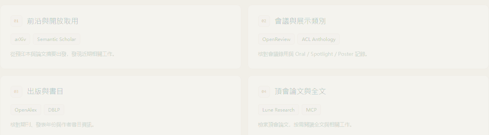

# ScholarGuide

**A research agent that shows its evidence — and its limits.**

[English](README.md) · [简体中文](README.zh-CN.md)

[](LICENSE)
[](https://www.python.org)
[](#install)
[](https://github.com/ConmuYan/Scholarguide/releases)
[](https://github.com/ConmuYan/Scholarguide/actions/workflows/release.yml)

ScholarGuide turns a research question into a **reading list you can check**: every recommendation carries an abstract quote, its source, publication metadata and a stated reason — with model inference labelled separately. It runs on your machine, with your own API key, and you can replay every step it took.



## Why another paper search?

| | Typical paper search | Chat with a PDF | **ScholarGuide** |
|---|---|---|---|
| Output | A ranked list | Prose that may be unsupported | A bounded list **plus** the quote it rests on |
| Evidence | Not shown | Hard to trace | Quote ↔ abstract match verified, per paper |
| Process | Hidden | Hidden | Every tool call, timing and error in Activity |
| Failure | Silent | Silent or invented | Explicit gaps, partial results, no fake completion |
| Data | Vendor cloud | Vendor cloud | Your machine, your keys |

The design rule: **a recommendation is only as good as the sentence in the abstract that supports it.** Anything the model infers beyond that is labelled as inference, and anything unverified is labelled as untested.

## What it does

- **Grounded discovery** — multi-source retrieval over arXiv, OpenAlex, Semantic Scholar, DBLP, OpenReview, ACL Anthology, and optionally Lune. Recommendations carry an abstract quote that is checked against the abstract text.
- **Evidence boundaries, not confidence theatre** — author-reported findings, model synthesis, and unverified hypotheses are rendered as three different things. Missing evidence is a stated gap, not a guess.
- **A workflow you can inspect** — `plan → search → assess → deliver`, replayable event by event in Activity, with source health, per-call duration and error classes.
- **Stopping that behaves** — cancel keeps verified results, blocks new work, and never silently re-issues a paid request whose outcome is unknown.
- **Recovery that refuses to guess** — after a crash or restart, an interrupted run is marked interrupted. It is not replayed automatically.
- **Local-first by construction** — keys live in your user profile, the server binds to loopback only, and no telemetry leaves the machine.
- **Versioned API** — `/api/v1/search`, `/api/v1/chat`, `/api/v1/operations/{id}`, SSE events, idempotency keys, documented error taxonomy.
- **Three languages, two themes** — English / 简体中文 / 繁體中文, light and dark, keyboard operable.



## Install

Requires **Python 3.11+**. No admin rights, no containers, no GPU.

**macOS / Linux**

```bash
curl -fsSL https://github.com/ConmuYan/Scholarguide/releases/latest/download/install.sh | sh
scholarguide web --open
```

**Windows (PowerShell)**

```powershell
irm https://github.com/ConmuYan/Scholarguide/releases/latest/download/install.ps1 | iex
scholarguide web --open
```

The installer verifies the release checksum, creates an isolated virtual environment under your user directory, and leaves your data in `~/.scholarguide` (`%USERPROFILE%\.scholarguide` on Windows). Prefer to read before you run: download `install.sh` / `install.ps1` and inspect it first.

<details>
<summary>Run from source instead</summary>

```bash
git clone https://github.com/ConmuYan/Scholarguide.git
cd Scholarguide
python -m pip install -r requirements.txt
python app.py web --open
```
</details>

## Configure

1. Open the local page and go to **Models** → add your provider (any OpenAI-compatible endpoint, e.g. DeepSeek), test the connection.
2. Optional: **Sources** for scholarly credentials (Semantic Scholar key recommended; arXiv needs none).
3. Start with **Offline demo** — fixed fixtures, zero network calls — then switch to **Online search**.

Lune is optional. Authorise it once with `python scripts/lune_oauth.py --port 8768 --open` (or set `LUNE_API_KEY`), then keep the daily allowance window rolling:

```bash
python lune_quota_schedule.py --enable --mode assume_full_allowance_at_reset --reset-utc-hour 0
python lune_quota_schedule.py --status
```

The scheduler only manages the *window*: Lune exposes no balance endpoint, so each automatic entry is marked as an assumption and the ledger still reports `external_usage_unknown`. Use `--mode manual` if you prefer to confirm the number yourself.

Keep it current:

```bash
scholarguide update --check
scholarguide update --yes
```

Updates verify the release checksum and never touch `~/.scholarguide` — your keys, profiles, quota ledger and history survive every upgrade, and the old version stays on disk.

On v0.1.0 or v0.1.1? `update` was added in v0.1.2 — install the current release once (the command above for your platform) and the one-command flow starts working. Your keys, profiles, quota ledger and history are untouched; see [`docs/INSTALL.md`](docs/INSTALL.md#upgrading-from-v010-or-v011).

Keys are stored locally and never returned to the browser. Live runs bill **your** provider account; ScholarGuide ships no shared credits.

## Use it as an API

```bash
curl -s http://127.0.0.1:8765/api/v1/search \
  -H 'Content-Type: application/json' \
  -H 'Idempotency-Key: demo-001' \
  -d '{"mode":"demo","scenario":"satisfied","query":"offline check"}' \
  | jq '{state, links}'
```

Poll `links.self` until `state` is terminal, then read `result.papers`, `result.gaps` and `result.status`. `complete` means the model judged the request satisfied — not that the papers are good. Unknown outcomes are never retried automatically.

<details>
<summary>Python client</summary>

```python
import time, requests

base = "http://127.0.0.1:8765"
op = requests.post(f"{base}/api/v1/search", json={
    "query": "5 papers on RAG evaluation", "source": "multi",
    "client_request_id": "eval-001",
}, timeout=10).json()

while op["state"] in {"queued", "running"}:
    time.sleep(1)
    op = requests.get(base + op["links"]["self"], timeout=10).json()

for paper in op["result"]["papers"]:
    print(paper["rank"], paper["title"], paper["evidence"]["quote_verified"])
```
</details>

Full contract: [`docs/API.md`](docs/API.md) · machine-readable: `http://127.0.0.1:8765/openapi.json`

## Architecture

```text
┌──────────────────────────────────────────────────────────────┐
│  Web UI  (vanilla HTML/CSS/JS, no build step)                 │
│  Search · Chat · Sources · Models · Activity                   │
└───────────────┬──────────────────────────────────────────────┘
                │  HTTP + SSE  (loopback only)
┌───────────────▼──────────────────────────────────────────────┐
│  Local Python service (stdlib HTTP server)                    │
│  ├── /api/v1  product API: operations, events, cancel          │
│  ├── Jobs     background search + durable journal             │
│  └── ChatService  stateful turns, SQLite checkpoints          │
└───────────────┬──────────────────────────────────────────────┘
                │
   ┌────────────┼────────────────┬─────────────────┐
   ▼            ▼                ▼                 ▼
 Retrieval   LLM planner     Evidence checks   Activity trace
 router      (JSON schema)   quote ↔ abstract  (public events)
   │
   ├── arXiv · OpenAlex · Semantic Scholar · DBLP
   ├── OpenReview · ACL Anthology
   └── Lune (MCP, optional, quota-gated)
```

Design notes: [`docs/ARCHITECTURE.md`](docs/ARCHITECTURE.md) · [`docs/DESIGN_INVARIANTS.md`](docs/DESIGN_INVARIANTS.md)

## Screenshots

| Sources & capabilities | Mobile |
|---|---|
|  |  |



<sub>Screenshots are real captures of the app running against **offline fixtures** — no live provider data, no user records.</sub>

## Docs

| Doc | What's inside |
|---|---|
| [`docs/INSTALL.md`](docs/INSTALL.md) | installers, upgrade, data locations |
| [`docs/API.md`](docs/API.md) | v1 endpoints, SSE, idempotency, error codes |
| [`docs/ARCHITECTURE.md`](docs/ARCHITECTURE.md) | modules, execution paths, storage |
| [`docs/MCP_AND_SKILLS.md`](docs/MCP_AND_SKILLS.md) | MCP transport bounds, reviewed skills |
| [`docs/UI.md`](docs/UI.md) | layout, tokens, interaction contracts |
| [`docs/DEVELOPMENT.md`](docs/DEVELOPMENT.md) | module map, verification, doc index |
| [`docs/PUBLISHING.md`](docs/PUBLISHING.md) | how this repo and its releases are produced |
| [`frontierlitbench/EVALUATION_GUIDE.md`](frontierlitbench/EVALUATION_GUIDE.md) | reviewed FB-1.1 tasks, chat imports, scoring and the ScholarGuide matrix |

## Verify it yourself

```bash
python -m pip install -r requirements-dev.txt
python -m unittest discover -s tests -v
```

The suite is offline by default: synthetic sources, temporary stores, isolated browser profiles. Browser tests need Chrome + a matching driver. Nothing in the test path calls a paid model or a live academic API.

## Status & limitations

This is a **research prototype**, published as-is. Known boundaries, stated plainly:

- Recommendations are **abstract-level**. `quote_verified=true` means the quote appears in the abstract — not that the finding holds, nor that the full paper supports it.
- Publication metadata (venue, acceptance, presentation type) depends on what each source exposes; unsupported conditions surface as gaps.
- Multi-source routing and Lune access depend on your own credentials and quotas. arXiv rate-limits per egress IP.
- The service is **single-user, loopback-only**, and has no authentication. Do not expose the port to the internet without an authenticated proxy.
- Deletion of saved sessions/runs is **intentionally disabled** (HTTP 503) until a cross-process lifecycle protocol is proven safe.
- No claim is made about research quality or speed versus other systems; there is no published benchmark here.

## Contributing

Issues and PRs are welcome. Please keep the invariants intact: no silent retries of paid calls, no fabricated citations, evidence labels must stay honest, and the test suite must pass offline.

## License

[MIT](LICENSE) for the original code. Vendored `vendor/gptr_arxiv.py` keeps its upstream **Apache-2.0** license — see [NOTICE.md](NOTICE.md). Academic-source logos belong to their owners and are **not** covered by MIT.

If ScholarGuide saves you a bad afternoon of paper hunting, a ⭐ helps others find it.
