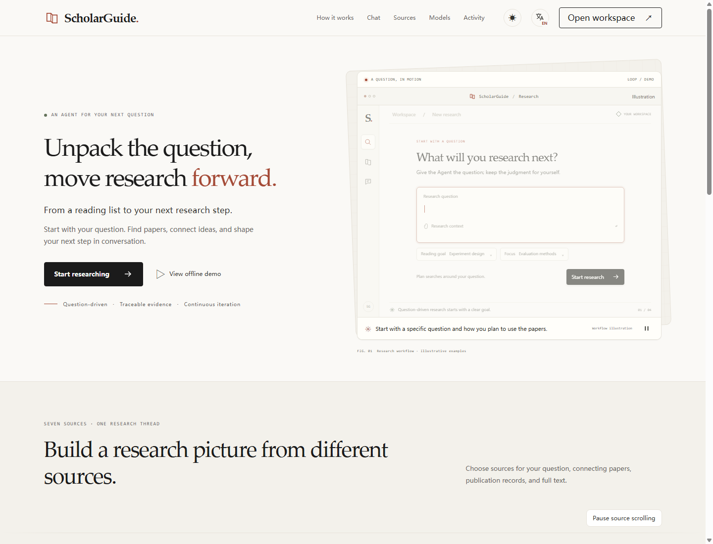
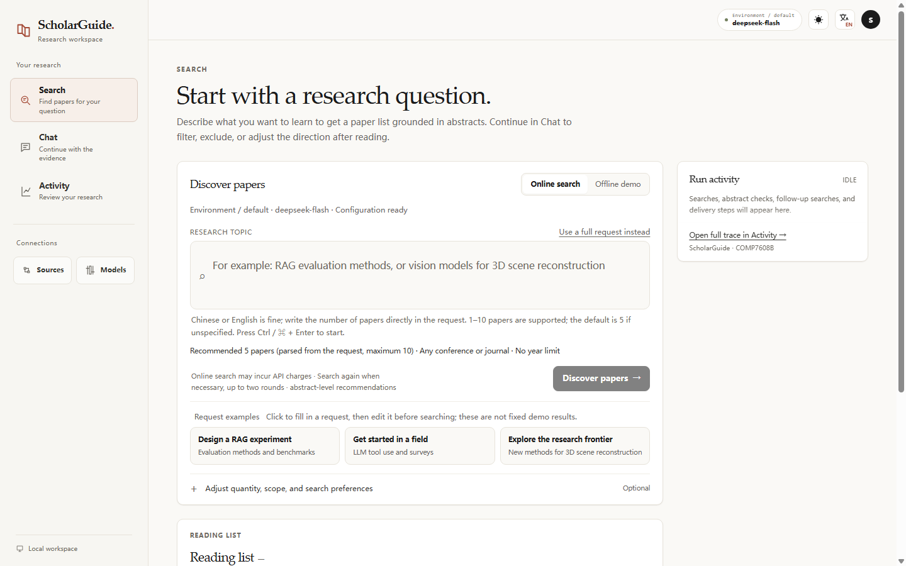
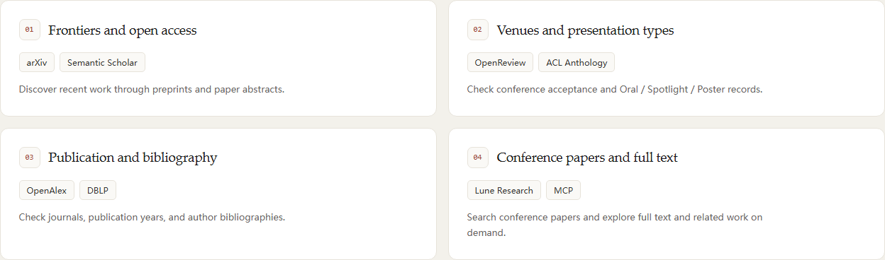
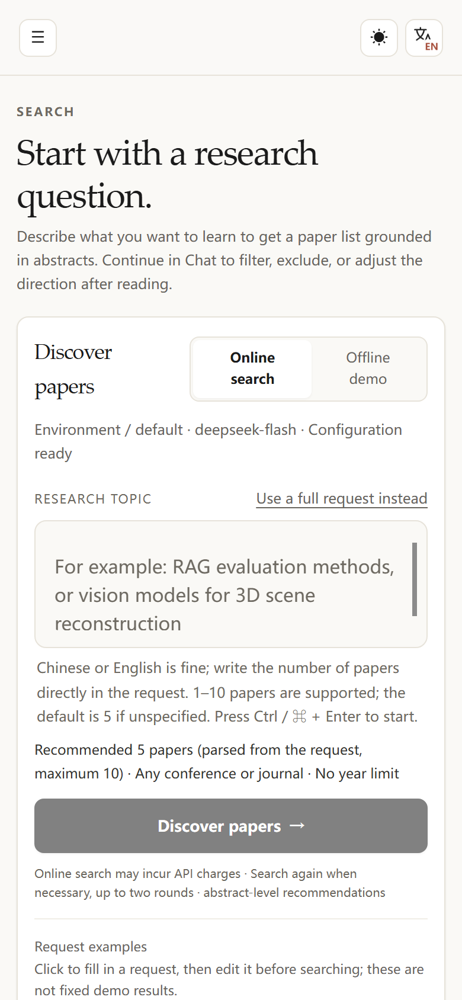
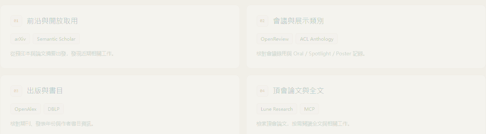

# ScholarGuide

**一个把证据摊开给你看的研究 Agent。**

[English](README.md) · [简体中文](README.zh-CN.md)

[](LICENSE)
[](https://www.python.org)
[](#安装)
[](https://github.com/ConmuYan/Scholarguide/releases)

输入一个研究问题，得到一份**可以逐条核对**的论文清单：每篇都带摘要引文、来源、出版信息与推荐理由；模型推断与作者报告分开标注。全部在本机运行，用你自己的 key，跑完还能逐事件回看它做了什么。



## 和别的方案差在哪

| | 普通论文搜索 | 直接问聊天模型 | **ScholarGuide** |
|---|---|---|---|
| 产出 | 一个排序列表 | 可能没有依据的长文 | 清单 **+** 支撑它的那句摘要 |
| 证据 | 不展示 | 难追溯 | 引文与摘要逐篇校验 |
| 过程 | 黑箱 | 黑箱 | Activity 里每次调用、耗时、错误 |
| 失败 | 静默 | 静默或编造 | 明确缺口、部分结果、不假装完成 |
| 数据 | 厂商云端 | 厂商云端 | 你的机器、你的 key |

设计原则只有一句：**推荐的可信度，不超过支撑它的那句摘要。** 超出摘要的推断一律标注，无法核验的一律说明未验证。

## 能力

- **有据可查的检索** —— arXiv、OpenAlex、Semantic Scholar、DBLP、OpenReview、ACL Anthology，可选接入 Lune；推荐附带与摘要原文比对的引文。
- **分清三类信息** —— 作者报告、模型归纳、待验证假设分别呈现；证据不足就写成缺口，不补脑。
- **可回放的工作流** —— `规划 → 检索 → 评估 → 交付`，Activity 中逐事件回看来源健康、耗时与错误分类。
- **诚实的停止与恢复** —— 取消保留已核验结果；崩溃或重启后的中断任务标记为中断，**不会**自动重放可能已计费的请求。
- **本地优先** —— 密钥只在本机用户目录，服务只监听回环地址，无遥测。
- **版本化 API** —— `/api/v1/search`、`/api/v1/chat`、`/api/v1/operations/{id}`，SSE 事件、幂等键、明确的错误分类。
- **三语双主题** —— 简体中文 / 繁體中文 / English，明暗主题，键盘可操作。



## 安装

需要 **Python 3.11+**，无需管理员权限、无需容器、无需 GPU。

**macOS / Linux**

```bash
curl -fsSL https://github.com/ConmuYan/Scholarguide/releases/download/v0.1.0/install.sh | sh
scholarguide web --open
```

**Windows (PowerShell)**

```powershell
irm https://github.com/ConmuYan/Scholarguide/releases/download/v0.1.0/install.ps1 | iex
scholarguide web --open
```

安装器会校验发布包哈希、在用户目录建独立虚拟环境，数据放在 `~/.scholarguide`（Windows 为 `%USERPROFILE%\.scholarguide`）。想先看再跑，可以先下载 `install.sh` / `install.ps1` 检查。

<details>
<summary>从源码运行</summary>

```bash
git clone https://github.com/ConmuYan/Scholarguide.git
cd Scholarguide
python -m pip install -r requirements.txt
python app.py web --open
```
</details>

## 配置

1. 打开本地页面 → **Models**：填入任意 OpenAI 兼容服务（如 DeepSeek），点测试连接。
2. 可选：**Sources** 配置学术来源凭据（建议配 Semantic Scholar key；arXiv 不需要）。
3. 先用 **离线演示**（固定样例、零网络），再切 **在线搜索**。

密钥只存本机，不回传浏览器。在线检索消耗**你自己**的模型与来源配额。

## 当 API 用

```bash
curl -s http://127.0.0.1:8765/api/v1/search \
  -H 'Content-Type: application/json' \
  -H 'Idempotency-Key: demo-001' \
  -d '{"mode":"demo","scenario":"satisfied","query":"offline check"}' \
  | jq '{state, links}'
```

轮询 `links.self` 直到终态，再读 `result.papers` / `result.gaps` / `result.status`。`complete` 只表示模型判断条件已满足，不代表论文质量高；结果未知时不会自动重试。

<details>
<summary>Python 客户端</summary>

```python
import time, requests

base = "http://127.0.0.1:8765"
op = requests.post(f"{base}/api/v1/search", json={
    "query": "推荐 5 篇 RAG 评测论文", "source": "multi",
    "client_request_id": "eval-001",
}, timeout=10).json()

while op["state"] in {"queued", "running"}:
    time.sleep(1)
    op = requests.get(base + op["links"]["self"], timeout=10).json()

for paper in op["result"]["papers"]:
    print(paper["rank"], paper["title"], paper["evidence"]["quote_verified"])
```
</details>

完整契约见 [`docs/API.md`](docs/API.md)，机器可读：`http://127.0.0.1:8765/openapi.json`

## 架构

```text
┌──────────────────────────────────────────────────────────────┐
│  前端（原生 HTML/CSS/JS，无需构建）                            │
│  检索 · 对话 · 来源 · 模型 · 活动                              │
└───────────────┬──────────────────────────────────────────────┘
                │  HTTP + SSE（仅回环）
┌───────────────▼──────────────────────────────────────────────┐
│  本地 Python 服务（标准库 HTTP）                              │
│  ├── /api/v1  产品 API：operation、事件、取消                  │
│  ├── Jobs     后台检索 + 持久化 journal                       │
│  └── ChatService  多轮会话、SQLite checkpoint                 │
└───────────────┬──────────────────────────────────────────────┘
                │
   ┌────────────┼────────────────┬─────────────────┐
   ▼            ▼                ▼                 ▼
 检索路由    模型规划       证据核对          活动轨迹
             (JSON schema)  引文↔摘要         (公开事件)
   │
   ├── arXiv · OpenAlex · Semantic Scholar · DBLP
   ├── OpenReview · ACL Anthology
   └── Lune（MCP，可选，受额度门控）
```

更多：[`docs/ARCHITECTURE.md`](docs/ARCHITECTURE.md) · [`docs/DESIGN_INVARIANTS.md`](docs/DESIGN_INVARIANTS.md)

## 界面

| 来源与能力 | 移动端 |
|---|---|
|  |  |



<sub>截图来自**离线 fixture** 下真实运行的应用，不含真实 provider 数据或用户记录。</sub>

## 文档

| 文档 | 内容 |
|---|---|
| [`docs/INSTALL.md`](docs/INSTALL.md) | 安装、升级、数据位置 |
| [`docs/API.md`](docs/API.md) | v1 接口、SSE、幂等、错误码 |
| [`docs/ARCHITECTURE.md`](docs/ARCHITECTURE.md) | 模块、执行路径、存储 |
| [`docs/MCP_AND_SKILLS.md`](docs/MCP_AND_SKILLS.md) | MCP 传输边界、受控 Skills |
| [`docs/UI.md`](docs/UI.md) | 布局、token、交互契约 |
| [`docs/DEVELOPMENT.md`](docs/DEVELOPMENT.md) | 模块表、验证方式、文档索引 |
| [`docs/PUBLISHING.md`](docs/PUBLISHING.md) | 本仓库与发布包的生成方式 |

## 自己验证

```bash
python -m pip install -r requirements-dev.txt
python -m unittest discover -s tests -v
```

默认全套离线：合成来源、临时存储、隔离浏览器 profile。浏览器测试需要 Chrome 与匹配的 driver。测试路径不会调用付费模型或实时学术 API。

## 状态与边界

这是**研究原型**，按原样发布。明确的边界：

- 推荐是**摘要级**的。`quote_verified=true` 只表示引文出现在摘要中，不代表结论成立，也不代表全文支持。
- 会议、录用、展示类别等信息取决于来源暴露的字段；来源不支持的条件会显示为缺口。
- 多源路由与 Lune 取决于你自己的凭据与额度；arXiv 按出口 IP 限流。
- 服务是**单用户、仅回环**，没有用户认证。不要在无认证代理的情况下把端口暴露到公网。
- 会话/运行记录的删除**有意停用**（HTTP 503），直到跨进程生命周期协议被证明安全。
- 不与其它系统比较研究质量或速度，仓库内没有已发表的基准结果。

## 参与

欢迎 issue 与 PR。请保持这些不变量：不静默重试付费调用、不编造引用、证据标注必须诚实、离线测试必须通过。

## 许可

原创代码 [MIT](LICENSE)。`vendor/gptr_arxiv.py` 保留上游 **Apache-2.0**，见 [NOTICE.md](NOTICE.md)。学术来源 logo 归各自权利人所有，**不在** MIT 授权范围内。

如果这个项目帮你省下了一个下午的找论文时间，点个 ⭐ 能让更多人看到。
