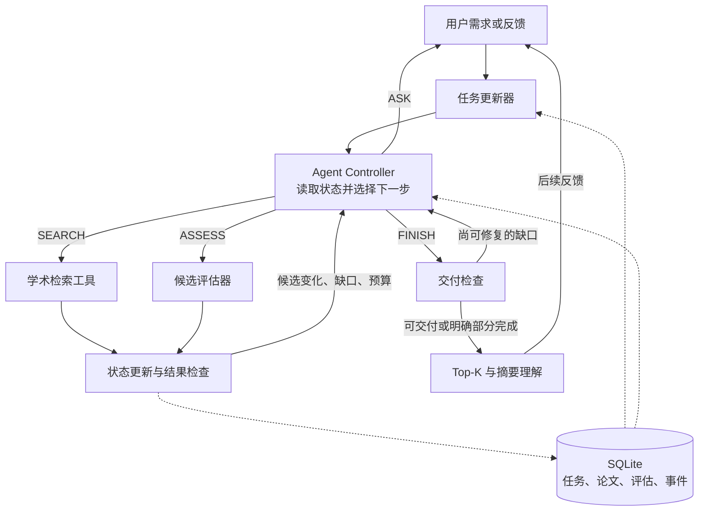

# ScholarGuide Architecture v2

状态：架构与实现规格；v2 状态机、SQLite 工作区、12×2 pilot 与多源 extension 已实现。本文细化 PROJECT_PLAN.md，主实验仍保留单 Agent、AI/CS、摘要级理解、arXiv 必需来源和有限预算；多源路由是可选扩展，不改变 arXiv 主实验。GPT Researcher 仍只是 runtime 部件复用来源。

## 1. Project objective

**中文：**构建一个有状态的交互式论文推荐 Agent，在有限检索与计算预算内，将用户逐步明确的研究需求转化为有证据支持的 Top-K 推荐；通过维护当前任务、复用文献证据，并根据观察选择搜索、评估、澄清或交付，持续修正推荐。

**English, suitable for the proposal:**

> ScholarGuide aims to build a stateful agent for interactive paper recommendation. Given an evolving research request, the agent maintains an explicit task specification, acquires and evaluates scholarly evidence, and produces a Top-K reading list with concise, source-grounded explanations. When users provide feedback, it updates the task, reuses compatible evidence, and chooses whether to reassess existing candidates, conduct a targeted search, ask a necessary clarification question, or deliver a revised result under a bounded resource budget.

质量、效率和交互体验是待评价目标，不写成已经实现的提升。

## 2. Motivation and challenges

### 2.1 Motivation：按“需求—不足—洞察—设计”的逻辑组织

论文推荐服务于具体研究目的。主题相似的结果未必适合入门阅读、方法比较或实验设计。用户的偏好还可能在阅读初次结果后发生变化或变得明确。因此，系统需要在多轮交互中同时解决“现在要完成什么”和“已有证据是否足以完成它”。

仅保存聊天历史，并不会自动定义当前有效的要求、哪些评分已经过期，以及何时应该继续花费检索预算。重新执行整套流程可以处理部分变化，但会重复工作；直接复用旧判断则可能延续与当前任务不匹配的推荐。澄清也有成本，应当针对会改变行动的歧义。

**核心 insight：当前任务理解与文献证据具有不同的更新频率。** 用户改变研究目的后，论文的摘要通常仍然可用，但它的相关性判断可能已经失效。将两者显式分开，并让验证结果驱动后续动作，可以形成更容易控制、诊断和评估的闭环。

**English, suitable for the proposal:**

> Interactive paper discovery requires aligning scholarly evidence with a research objective that may be incomplete or evolve during a conversation. A relevant first response does not ensure that later recommendations remain consistent with revised preferences. Repeating the entire search can waste resources, while reusing prior relevance judgments without checking their assumptions can preserve errors. We therefore distinguish the evolving task specification from reusable paper evidence, and use explicit observations and validity checks to guide the agent's next action. Our study evaluates whether this design improves adaptation to user feedback or reduces additional work without sacrificing recommendation quality.

以上是本项目的问题论证，不声称所有现有产品都缺少这些能力。

### 2.2 四个挑战及其设计对应

| Challenge | 难点 | 对应设计 |
|---|---|---|
| C1. Intent continuity | 反馈可能重申、扩展、替换或冲突；不能丢弃未被修改的要求 | 基于原文来源的 TaskState 更新和显式 unresolved 字段 |
| C2. Evidence reuse under changing intent | 原始摘要仍有效，旧相关性和解释却可能失效 | 文献证据与任务相关评估分离；内容哈希与语义键控制复用 |
| C3. Reliable action and delivery | 查到论文不等于已评估；引用存在不等于支持解释；模型也会过早结束 | 结构化观察、独立程序检查、语义 unknown 与部分结果 |
| C4. Quality–cost–interaction trade-off | 更多搜索、评估和提问都有成本，不能只限制搜索次数 | 工具、LLM、时间与澄清预算；一次只规划下一步 |

## 3. 架构决策：一个 Agent，两种反馈循环

- **跨用户轮次的循环：**新请求/反馈 → 更新任务 → 识别变化和歧义 → 从已有状态继续。
- **一次执行中的循环：**观察 → 计划下一步 → 调用工具 → 检查 → 新观察，直到交付或等待用户。

“两个循环”描述控制层次，不表示运行两个独立 Agent。所有语义调用可使用同一模型。任务更新器和论文评估器是有固定输入输出的函数，不具有独立自治权。



图中持久化是逻辑依赖；所有成功的状态变更与事件、预算结算一起提交。预算耗尽的强制停止由 runtime 直接交付已有合法结果，不再等待模型选择 FINISH。

## 4. 模块职责与边界

### A. Task updater：只在用户输入事件后更新意图

输入：当前 TaskState、相关原始消息、上次结果和新消息。

输出：带来源的字段 patch、changed_fields、unresolved，以及一条简短更新说明。程序将 patch 合并到现有任务；没有明确修改的要求予以保留。

TaskState 至少包含 topic、purpose、K、reading_goal、category/quota、excluded_paper_ids、prefer_recent、venue、year_from、year_to、requirement_origins、assumptions、unresolved、task_revision。venue/year 是硬约束；prefer_recent 只是排序软偏好。

- 明确要求与系统暂定解释分开，不能把猜测提升为用户硬要求。
- 来源包含 message_id 和原文片段；程序检查片段存在，语义对应仍可能出错。
- “第一轮已说过”不是独立的强制提问分支。直接修正已知要求；仅对剩余关键歧义提问。
- 用户明确改变目标时更新目标；不能机械地把所有新旧条件累加。
- 初始意图不明确时也可以询问，不必等到首次推荐失败。

### B. Agent controller：唯一的动作选择者

读取当前任务、候选的紧凑视图、检查结果、最近动作和剩余预算。输出一条短计划及四种动作之一：

| Action | 输入与输出 | 说明 |
|---|---|---|
| SEARCH | source/query → 新论文 ID、工具状态及 provenance | 单源直接检索；多源由 `retrieval.py` 选择子集、去重融合并记录每源状态；不把新论文自动当作已评估 |
| ASSESS | paper_ids → 当前任务下的相关性、类别、理解句、证据和 unknown | 评估新候选或失效判断；内部可按小批次执行 |
| ASK | question、affected_field、可能改变的行动 → awaiting_user | 针对关键意图歧义，保存状态并返回前端 |
| FINISH | 当前候选清单 → 交付检查及结果 | 不允许通过生成新的标题/链接补齐结果 |

RERANK 从可选动作改为程序派生操作：评估更新、K 改动或排除列表改变后自动重新选择。这样不用为了可计算的排序多调用一次决策模型。

短计划包含 subgoal、action、expected_observation 和 decision_reason，例如“确认现有候选中是否有足够医疗评测论文；先评估这些候选，数量不足再补搜”。不生成长链式计划或完整工作流 DAG。

首版可以继续使用现有 JSON LLM 接口实现动作分发。JSON 可解析不代表内容正确，必须保留本地字段、ID、预算和动作合法性验证。未来可以替换为原生 function calling，不改变上述接口。

### C. Tool executor and assessor：只执行清晰的接口

- arXiv adapter 返回真实元数据、摘要、来源与抓取时间；OpenAlex 可作为可配置替代，首版不依赖多源自动路由。
- 检索 ToolObservation 区分 success、empty、error，包含 query、returned_ids、new_count、error_type、retryable 和 measured_usage。网络故障不能描述为该主题没有论文。
- ASSESS 只接受候选池里的 ID，并读取对应摘要与当前 TaskState。返回 relevance、category_status、understanding_sentence、evidence_quote、unknown_reason、assessment_key。
- 搜索与评估是不同阶段，但正常路径仍为 SEARCH → ASSESS。分开后可选择先评估已有候选、补搜、再只评估新增候选。
- 不重复评价完全相同的内容和需求；格式或引用不合格时可进行一次有错误说明的修复。

### D. Verifier and selector：提供可操作观察

采用两层检查，避免把程序检查包装为语义正确性保证：

1. **程序可检查：**ID 属于候选、论文不重复、排除项未出现、数量、引文子串、评估版本兼容、预算，以及按当前模型标签计算的类别配额。
2. **仍依赖语义判断：**主题是否相关、类别是否为主要贡献、理解句是否得到摘要支持。首版使用评估器返回 yes/no/unknown，并做人工结果评测；不增加一个每步运行的 Critic Agent。

每步返回 VerificationReport，例如 pending_assessment_ids、stale_assessment_ids、eligible_count、unmet_requirements、unknown_count、last_action_effect 和 remaining_budget。

- 配额达到只代表按当前标签达到；不是人工真值。
- 没有足够证据的论文不用于满足硬性类别要求。
- 明确约束已满足且无影响行动的未决项时允许交付；复杂任务仍可在预算内继续搜索。
- FINISH 有可修复缺口时给控制器一次明确观察；无预算或持续无进展时交付部分结果。

### E. Session store and runtime：负责持久化、上下文与执行边界

SQLite 只需少量逻辑对象：session/task、papers、assessments、events。可以使用 JSON 列存主体，不必设计庞大数据库。

每一步结束保存任务状态、工具结果、事件和预算。ASK 将状态改为 awaiting_user 后释放后台工作。用户回答使用同一 session_id 恢复，不能重置已有预算。

恢复保证限于“从已提交状态继续”：未提交的外部请求可能在崩溃后重复执行，首版不宣称 exactly-once。只读检索允许有界重试，重复候选由稳定 ID 合并。记录在途动作以便区分故障恢复与新的主动搜索。

Context builder 是 runtime 内的小函数，不需要新 Agent：

- 保存完整可恢复记录，但每次决策只传当前任务、来源片段、未决项、候选评估摘要、最近观察与预算。
- 全文摘要送给对应论文的 ASSESS 调用，不在每个决策轮次重复塞入所有摘要。
- 任务修正时可读取原始消息，避免总结错误永久覆盖用户原文。短会话可直接读全部用户消息。
- 运行环境配置和密钥由程序管理，模型只看到所需的工具接口。

## 5. 正确复用：task revision 用于审计，语义键用于有效性

仅比较 task_revision 会导致两种问题：改 K 也全量重评；或者为了复用而放过真正改变研究目的的旧判断。因此分开：

```text
content_hash = hash(保留的标题 + 摘要)
semantic_key = hash(topic, purpose, category, assessor/model/prompt_version)
assessment_key = (paper_id, content_hash, semantic_key)
```

task_revision 记录任务更新的历史；是否可复用由 assessment_key 决定。

| 变化 | 原始论文数据 | 相关性/理解判断 | 程序操作 |
|---|---|---|---|
| K 变化 | 复用 | 语义键相同则复用 | 重新选择 |
| 排除具体论文 | 复用 | 复用 | 过滤后选择 |
| 优先较新论文 | 复用 | 复用 | 按软偏好调整排序 |
| 同类别配额数量变化 | 复用 | 复用 | 重新检查清单配额 |
| 主题、用途、类别改变 | 复用 | 标记过期，重新评估 | 评估后选择 |
| 摘要/标题或评估器版本改变 | 更新/保留来源记录 | 对应判断过期 | 只重评受影响论文 |

哈希比较使用规范化后的字段序列化，不做“语义等价”的额外模型判断。措辞变化可能多算一次，但不会冒险自动判定等价。所有影响评估的新增字段必须纳入 semantic_key。

首版的 understanding_sentence 与当前任务共同生成，所以也受同一评估键约束；不把 LLM 写的句子当作原始证据。原文片段单独存储。

## 6. Budget-aware control：可实现的启发式

保留 PROJECT_PLAN 中的上限：每阶段六次动作决策、24 次实际 LLM 请求、120 秒主动执行；首轮两次逻辑搜索，每次最多十篇；反馈阶段最多一次新增搜索，最多两个反馈阶段；会话最多四次搜索、40 篇候选。数字先在 dev 检查再冻结。

任务更新、动作决策、评估、JSON 修复都计入 LLM 用量。首次搜索后的正常两轮路径 SEARCH → ASSESS → SEARCH → ASSESS → FINISH 为五次动作，符合起始决策上限。ASK 后恢复沿用剩余预算，等待用户单列。

初始策略原则：

1. 已明确的意图直接落实；不同解释会实质改变行动时才考虑 ASK。
2. 现有候选可验证时优先评估，不默认先补搜。
3. 评估后仍有候选/类别缺口，再考虑有针对性的 SEARCH。
4. 重复查询、同键重复评估、无状态变化的动作被拒绝或触发停止；允许有明确错误记录的有界修复。
5. 没有可用合法动作或预算耗尽时，输出已有结果和缺口。

程序只强制合法性与预算；语义行动由模型结合观察决定。上述优先级是可评测策略，不能把预设动作表作为在线成功证据。

这不是最优成本策略，也不需要额外训练成本预测器。评价实际资源使用与质量即可；继续搜索的收益和多余询问的损失通过评测观察。

## 7. 论文写法中的 contributions

可直接用于 proposal 的三条：

1. **A stateful application for interactive paper recommendation.** We implement an end-to-end system that uses scholarly search tools, evaluates candidate papers, and updates recommendations across user turns.
2. **Explicit task calibration with compatible evidence reuse.** We separate evolving user requirements from paper evidence, track the validity of task-dependent assessments, and use this state to guide search, assessment, clarification, and delivery.
3. **An evaluation of adaptation quality and incremental resource use.** We compare against a general stateful tool agent and a candidate-rebuilding variant, measuring recommendation quality, clarification behavior, latency, cost, and observed failures.

使用“we implement / we evaluate”应以实际完成为前提；当前 proposal 可写“we propose to implement / we will evaluate”。不使用 first、optimal、guaranteed、state-of-the-art 等未证实描述。

## 8. 实现映射与最小验收

| 文件 | 职责 | 状态（2026-10-17） |
|---|---|---|
| common.py | TaskState、Action、ToolObservation、Assessment、VerificationReport 类型 | 沿用；TaskState 以 dict 落库 |
| state.py + state_schema.sql | SQLite 状态、事件、内容/语义键、恢复 | 已实现，10 张表；tests/test_state.py |
| controller.py | 任务 patch、决策上下文组装、四动作结构化输出 | 已实现；动作集由 `allowed_actions` 枚举 |
| tools.py | search / assess / decision 纯函数 + cost_units 账本 | 已实现；workflow 与 session 共用 |
| reuse.py | 复用计划、交付校验、复用事件 | 已实现；见 DESIGN_INVARIANTS I2/I4 |
| session.py | runtime 调度、预算、执行、check/select、提交与停止 | 已实现（CLI `chat`） |
| workflow.py | 单轮基准路径（S/A），保持原行为 | 改为调用 tools.py；回归测试不变 |
| source.py | 7-provider registry + 统一 Paper provenance；多源失败按源降级 | 扩展 |
| retrieval.py | 意图感知源路由、查询变体、融合排序、DeepSeek 补缺 | 扩展 |
| prompts.py / llm.py | 任务更新、动作决策、候选评估三种调用；同一模型可承担 | 新增 TASK_UPDATE / ACTION |
| webapp.py / web/ | 首轮、反馈、澄清回答三类输入，同一核心；显示事件与证据 | 未改动（本轮范围：CLI 先行） |
| evaluation/ | 多轮任务、G/R/C 对照、标签与资源统计 | 新增 `--methods V2` 与五项指标 |

实现说明：任务状态以 JSON 存在 `task_versions.task_json`，避免为一个字段改表；判断以
`(paper_id, content_hash, semantic_key)` 为主键；预算同时写 `budget_ledger` 与会话 `budget_json`。

先实现一个串行 loop，保持每个 session 同时只有一个执行者，减少状态竞争。只有无依赖的工作才考虑并行；首版不以并发为实现前提。

验收重点：

- 首次请求真实执行 SEARCH → ASSESS → 根据观察补搜或 FINISH。
- 明确反馈更新任务后可直接用已有兼容评估重新选择，无额外搜索。
- 主题变化必然使旧语义键失效；在缺少新评估时不能把旧判断当作当前判断。
- ASK 后用同一会话和剩余预算恢复；已确认的约束仍被保留。
- 工具 error 与 empty 区分；预算耗尽、重复动作或引用不合格时不会伪造完成。
- 事件记录能重建“改了什么、做了什么、依据什么、花了多少”，不要求暴露模型隐藏推理。

评测沿用 4 dev + 12 test 和 G/R/C，统一所有版本的底层可靠性检查。分别记录校准错误、检索不足、语义判断错误和执行故障；不能把所有失败归到一个“LLM 不够强”。语义键失效采用单独受控测试，不移除正常对照的必要有效性校验来制造优势。

## 9. 前沿参考、证据锚点与适用边界

这里模仿的是“问题—机制—验证”的论证方式。以下工作支持具体设计思想，不证明本项目新颖或有效；框架能力与会议论文分开列出。

| 文献 | 核对位置/思想 | 对本项目的启发 | 不直接迁移的部分 |
|---|---|---|---|
| ReAct, ICLR 2023 [1] | Abstract：interleaved reasoning and task-specific actions | 观察后决定下一步，工具结果进入循环 | 不把普通动作循环本身主张为新贡献 |
| Self-RAG, ICLR 2024 [2] | Abstract：retrieve on-demand；reflect on passages and generations | 根据需要检索，对证据与输出分别检查 | 特殊反思 token 与训练方案未复现；程序引文检查不等于其语义评价 |
| Modeling Future Conversation Turns..., ICLR 2025 [3] | Abstract：根据未来回合结果标注偏好；决定何时澄清 | 澄清的价值看后续任务效果 | 开放域 QA 训练效果不能直接当推荐效果 |
| QuestBench, NeurIPS 2025 [4] | Abstract：识别 minimal necessary question；能力与完整任务求解不同 | 澄清能力单独测，避免只统计问题数量 | 受控推理基准不等同开放式推荐 |
| FlowSearcher, ICLR 2026 [5] | Abstract：subgoals、workflow graph、hierarchical memory | 高层任务与低层工具执行职责分开，结构化记录可复用 | 不实现动态 DAG 或跨任务经验学习；它的 memory 与我们的会话证据存储不同 |
| TREACLE, NeurIPS 2024 [6] | Abstract：context-aware model/prompt selection with cost and latency constraints | 将费用和延迟作为决策与评估维度 | 首版不实现 RL 路由或学习模型级联 |

工程参考：

- LangChain 的 context engineering 文档 [7] 区分 model context、tool context 与 lifecycle context；据此将完整存储与每步模型输入分开。
- LangGraph persistence/interrupts [8] 支持持久状态与暂停恢复。本项目可以用 Python + SQLite 实现同类边界，无须立即迁移框架。
- Anthropic Managed Agents 工程文 [9] 区分 session、harness 和执行工具，并明确 session 不等于模型 context window。这支持运行器与持久记录解耦；我们不引入其云端执行环境或生产规模。

不存在一个需要机械遵守的统一“前沿标准架构”。本方案与上述公开设计原则一致，实际改进仍要通过与合理基线的比较确认。

## References

[1] ReAct: Synergizing Reasoning and Acting in Language Models. ICLR 2023. https://iclr.cc/virtual/2023/poster/11003

[2] Self-RAG: Learning to Retrieve, Generate, and Critique through Self-Reflection. ICLR 2024. https://www.iclr.cc/virtual/2024/poster/18095

[3] Modeling Future Conversation Turns to Teach LLMs to Ask Clarifying Questions. ICLR 2025. https://proceedings.iclr.cc/paper_files/paper/2025/hash/97e2df4bb8b2f1913657344a693166a2-Abstract-Conference.html

[4] QuestBench: Can LLMs ask the right question to acquire information in reasoning tasks? NeurIPS 2025. https://neurips.cc/virtual/2025/poster/121518

[5] FlowSearcher: Synthesizing Memory-Guided Agentic Workflows for Web Information Seeking. ICLR 2026. https://proceedings.iclr.cc/paper_files/paper/2026/hash/f15747119e0e3d00a34a7c17776d2999-Abstract-Conference.html

[6] Efficient Contextual LLM Cascades through Budget-Constrained Policy Learning. NeurIPS 2024. https://proceedings.neurips.cc/paper_files/paper/2024/hash/a6deba3b2408af45b3f9994c2152b862-Abstract-Conference.html

[7] LangChain: Context engineering in agents. https://docs.langchain.com/oss/python/langchain/context-engineering

[8] LangGraph: Persistence / Interrupts. https://docs.langchain.com/oss/python/langgraph/persistence ; https://docs.langchain.com/oss/python/langgraph/interrupts

[9] Anthropic: Managed Agents engineering article. https://www.anthropic.com/engineering/managed-agents

### 8.1 实现状态（2026-10-17）

- 已落地：SQLite 状态、四动作门控、版本化复用与失效、cost_units、多轮 CLI 与 `/chat` web 页面、V2 单轮与两轮消融入口；
  字段级来源（`requirement_origins`）、`assumptions`、`target_count`/排除/新近偏好已进入选择与评测。
- 已用真实 API 跑通：dev 4 + test 12 共 16 条单轮任务（`evaluation/results/v2final-all-20261017/summary.md`），以及 12 条两轮 × 3 方法消融（`evaluation/results/ablation-final-20261017/summary-llm-proxy.md`）。
- 质量指标（precision@5 / quota_met / reason_support_rate）仍为 null，等待 `docs/LABELING.md` 流程的团队盲标；程序指标与失败原因已记录。
- 未纳入本轮：web 多轮界面、多轮任务集的人工标签、消融实验的正式结论。
- 不在本轮改动：`PROJECT_PLAN.md`、`PROPOSAL_CORE.md`、`PROPOSAL_EVALUATION.md`（已冻结）。
